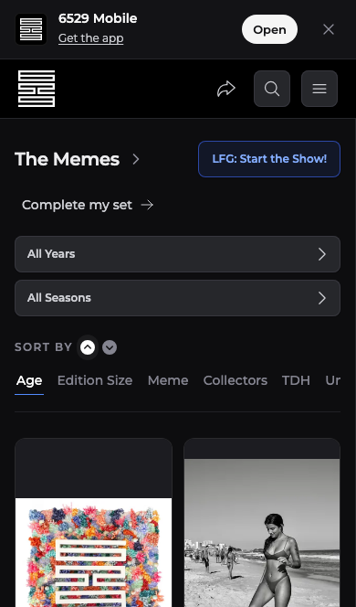
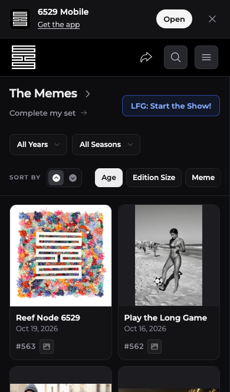
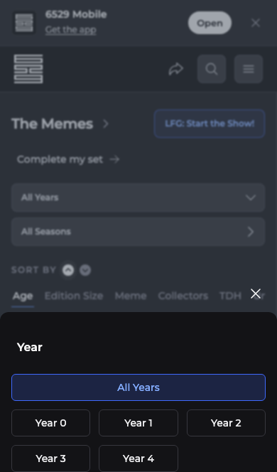
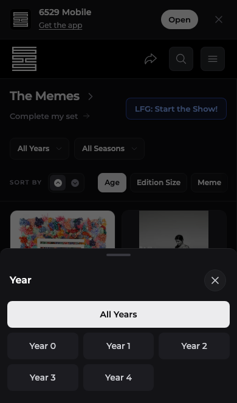

# The Memes mobile layout evidence

Phone captures use a 390px mobile browser viewport and staging collection data.
The development environment badge and developer tools are hidden in both sets.

| Before | After |
| --- | --- |
|  |  |
|  |  |

The first artwork moves from y=479px to y=346px. The first card changes from
417.25px to 263.5px tall. At 1440px, its position and dimensions remain identical:
x=170px, y=177px, width=279.75px, height=446px.
